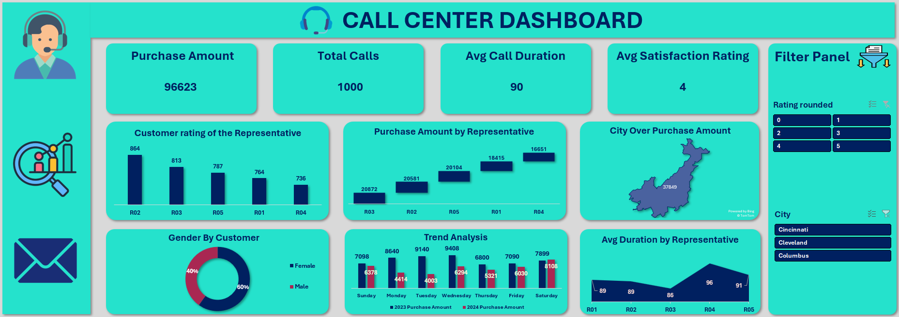

# 📞 Call Center Dashboard

An interactive business intelligence dashboard built in **Microsoft Excel** analyzing call center performance, sales outcomes, representative metrics, and customer demographics across **1,000 total calls** and **96,623** in purchase amount. Includes a dynamic **Filter Panel** (`Rating rounded` and `City`) for interactive exploration.

---

## 📌 Key Performance Indicators (KPIs)
* **Purchase Amount:** `96,623`
* **Total Calls:** `1,000`
* **Avg Call Duration:** `90`
* **Avg Satisfaction Rating:** `4`

---

## 📊 Visual Breakdown

### 1. Representative Performance
* **Customer rating of the Representative:** Column chart comparing representative scores across `R02` (`864`), `R03` (`813`), `R05` (`787`), `R01` (`764`), and `R04` (`736`).
* **Purchase Amount by Representative:** Waterfall chart illustrating purchase amounts across representatives (`R03`: `20,872`, `R02`: `20,581`, `R05`: `20,104`, `R01`: `18,415`, `R04`: `16,651`).
* **Avg Duration by Representative:** Area chart showing average call duration across `R01` (`89`), `R02` (`89`), `R03` (`86`), `R04` (`96`), and `R05` (`91`).

### 2. Customer & Geographic Insights
* **Gender By Customer:** Donut chart showing customer distribution between `Female` (`60%`) and `Male` (`40%`).
* **City Over Purchase Amount:** Map visualization highlighting regional purchase value (`37,849` shown on the selected region).

### 3. Time & Trend Analysis
* **Trend Analysis:** Clustered column chart comparing **2023 Purchase Amount** vs. **2024 Purchase Amount** from `Sunday` to `Saturday`, peaking in 2023 on `Wednesday` (`9,408`) and in 2024 on `Saturday` (`8,108`).

---

## 🎛️ Interactive Filters (Slicers)
* **Rating rounded:** `0`, `1`, `2`, `3`, `4`, `5`
* **City:** `Cincinnati`, `Cleveland`, `Columbus`

---

## 💡 Key Insights
* **Gender Split:** Female customers account for the majority (`60%`) compared to male customers (`40%`).
* **Representative Strengths:** `R02` leads in customer rating (`864`) and ranks second in purchase amount (`20,581`), while `R04` records the highest average call duration (`96`).
* **Year-over-Year Shifts:** While `2023` leads on weekdays such as Wednesday (`9,408` vs. `6,294` in `2024`), `2024` surpasses `2023` on Saturday (`8,108` vs. `7,899`).

---

## 🛠️ Tools & Features Used
* **Microsoft Excel** (`.xlsx`)
* **Pivot Tables & Pivot Charts** (Column, Waterfall, Area, Donut, and Map visuals)
* **Slicers & Filter Panel** for interactive cross-filtering

