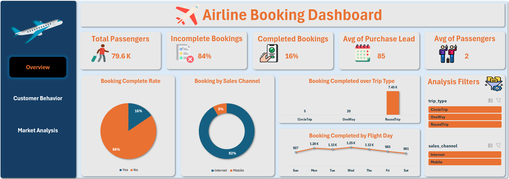

# 👥 HR Analytics & Attrition Dashboard

An interactive business intelligence dashboard built in **Microsoft Excel** analyzing workforce demographics, employee retention, attrition rates, and educational backgrounds across **2,925 total employees**. Equipped with a dynamic **Filter Panel** (`Job Role`, `Relationship Satisfaction`, `Work Life Balance`, and `Job Involvement`) for multi-dimensional HR analysis.

---

## 📌 Key Performance Indicators (KPIs)
* **Total Employee:** `2,925`
* **Male:** `1,754`
* **Female:** `1,171`
* **Ex-Employee:** `473`

---

## 📊 Visual Breakdown

### 1. Workforce Demographics & Education
* **Employee By Age:** Horizontal bar chart showing workforce distribution across age brackets: `25 - 34` (`1,098`), `35 - 44` (`1,005`), `45 - 54` (`489`), `Others` (`196`), and `Over 55` (`137`).
* **Employee By Marital Status:** Pie chart breaking down marital status into `Married` (`46%`), `Single` (`32%`), and `Divorced` (`22%`).
* **Employee By Education Fields:** Funnel chart ranking educational backgrounds: `Human Resources` (`1,203`), `Life Sciences` (`923`), `Marketing` (`318`), `Medical` (`264`), `Other` (`163`), and `Technical Degree`.
* **Employee By Education Degree:** Treemap illustrating degree distribution across `Bachelor's Degree`, `Master's Degree`, `Associates Degree`, `High School`, and `Doctoral Degree`.

### 2. Department, Travel & Tenure Analysis
* **Employee By Department:** Donut chart showing headcount split across `R&D` (`65%`), `Sales` (`31%`), and `HR` (`4%`).
* **Attrition Rate:** Donut chart comparing `Current Employees` (`84%`) vs. `Ex-Employees` (`16%`).
* **Employee over Business Travel:** Column chart categorizing travel frequency into `Travel_Rarely` (`2,075`), `Travel_Frequently` (`550`), and `Non-Travel` (`300`).
* **Years With Current Manager:** Area chart tracking employee tenure with their current manager from `0` to `9` years, with notable peaks at `2` years (`688`), `0` years (`522`), and `7` years (`430`).

---

## 🎛️ Interactive Filters (Excel Slicers)
* **Job Role:** `Healthcare Representative`, `Human Resources`, `Laboratory Technician`, `Manager`, `Manufacturing Director`, `Research Director`, `Research Scientist`, `Sales Executive`, `Sales Representative`
* **Relationship Satisfaction:** `1`, `2`, `3`, `4`
* **Work Life Balance:** `1`, `2`, `3`, `4`
* **Job Involvement:** `1`, `2`, `3`, `4`

---

## 💡 Key Insights
* **Overall Attrition Rate:** `16%` of the workforce (`473` employees) have left the organization, while `84%` remain active.
* **Core Age Demographic:** Employees aged `25 - 44` represent over `71%` of the total workforce (`2,103` out of `2,925`).
* **Department Concentration:** `R&D` makes up nearly two-thirds (`65%`) of the organization, followed by `Sales` (`31%`).
* **Low Travel Frequency:** The vast majority of employees (`2,075`) travel rarely for business.

---

## 🛠️ Tools & Excel Features Used
* **Microsoft Excel** (`.xlsx`)
* **Pivot Tables & Pivot Charts** (Bar, Column, Donut, Pie, Funnel, Treemap, and Area charts)
* **Slicers & Filter Panel** for interactive cross-filtering across KPI cards and visuals

