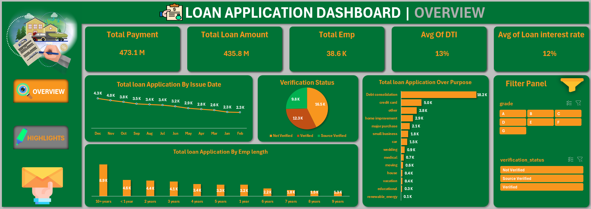
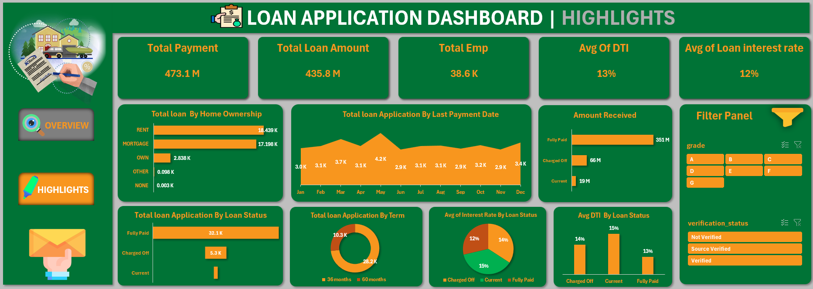

# 🏦 Loan Application Dashboard

An interactive multi-page business intelligence dashboard built in **Microsoft Excel** analyzing bank loan applications, repayment performance, borrower demographics, and credit risk across **38.6K applications** and **$435.8M in total loan volume**. Features a unified navigation sidebar and dynamic Slicers (`grade` and `verification_status`) across two views: **Overview** and **Highlights**.

---

## 📌 Key Performance Indicators (KPIs)
* **Total Payment:** `473.1M`
* **Total Loan Amount:** `435.8M`
* **Total Emp (Applications):** `38.6K`
* **Avg Of DTI (Debt-to-Income):** `13%`
* **Avg of Loan Interest Rate:** `12%`

---

## 📊 Dashboard Pages & Screenshots

### 1. Overview
Examines application trends over issue dates, borrower employment tenure, verification status, and loan purposes.

* **Total loan Application By Issue Date:** Line chart tracking monthly applications, peaking in `Dec` (`4.3K`), `Nov` (`4.0K`), and `Oct` (`3.8K`).
* **Verification Status:** Pie chart breaking down applications into `Not Verified` (`16.5K`), `Verified` (`12.3K`), and `Source Verified` (`9.8K`).
* **Total loan Application By Emp length:** Column chart showing borrower tenure, led by `10+ years` (`8.9K`), `< 1 year` (`4.6K`), and `2 years` (`4.4K`).
* **Total loan Application Over Purpose:** Horizontal bar chart led heavily by `Debt consolidation` (`18.2K`), followed by `credit card` (`5.0K`), `other` (`3.8K`), and `home improvement` (`2.9K`).

---

### 2. Highlights
Focuses on loan repayment status, amounts received, loan terms, home ownership, and risk metrics (`DTI` & interest rates) by loan status.

* **Total loan By Home Ownership:** Horizontal bar chart led by `RENT` (`18.439K`) and `MORTGAGE` (`17.198K`), followed by `OWN` (`2.838K`).
* **Total loan Application By Last Payment Date:** Area chart showing monthly payment volume from `Jan` to `Dec`, peaking in `May` (`4.2K`) and `Mar` (`3.7K`).
* **Amount Received:** Bar chart comparing collected amounts across `Fully Paid` (`351M`), `Charged Off` (`66M`), and `Current` (`19M`).
* **Total loan Application By Loan Status:** Funnel/bar breakdown across `Fully Paid` (`32.1K`), `Charged Off` (`5.3K`), and `Current`.
* **Total loan Application By Term:** Donut chart splitting loan terms between `36 months` (`28.2K`) and `60 months` (`10.3K`).
* **Avg of Interest Rate By Loan Status:** Pie chart comparing average interest rates across `Current` (`15%`), `Charged Off` (`14%`), and `Fully Paid` (`12%`).
* **Avg DTI By Loan Status:** Column chart comparing average DTI across `Current` (`15%`), `Charged Off` (`14%`), and `Fully Paid` (`13%`).

---

## 🎛️ Interactive Filters (Excel Slicers)
* **Grade (`grade`):** `A`, `B`, `C`, `D`, `E`, `F`, `G`
* **Verification Status (`verification_status`):** `Not Verified`, `Source Verified`, `Verified`

---

## 💡 Key Insights
* **Top Loan Purpose:** `Debt consolidation` accounts for nearly half of all loan applications (`18.2K` out of `38.6K`).
* **Strong Repayment Recovery:** Over `83%` of applications (`32.1K`) are `Fully Paid`, generating `351M` in received payments.
* **Short-Term Preference:** `36 months` loans (`28.2K`) are nearly triple the volume of `60 months` loans (`10.3K`).
* **Risk vs. Rate Correlation:** `Fully Paid` loans carry the lowest average interest rate (`12%`) and DTI (`13%`) compared to `Current` and `Charged Off` loans.

---

## 🛠️ Tools & Excel Features Used
* **Microsoft Excel** (`.xlsx`)
* **Power Query:** Data cleaning and preprocessing
* **Pivot Tables & Pivot Charts:** Line, Column, Horizontal Bar, Donut, Pie, Funnel, and Area charts
* **Slicers & Filter Panel:** Interactive filtering across both dashboard sheets

