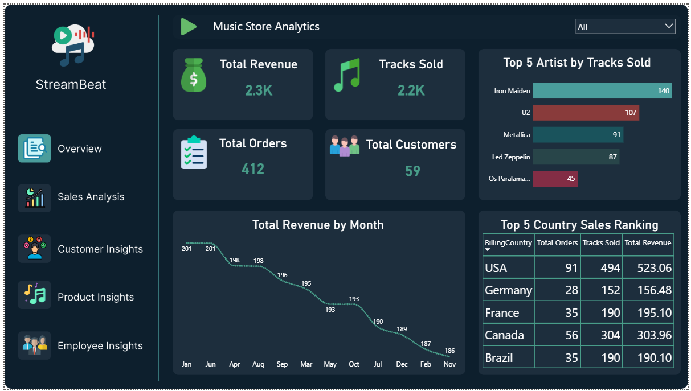
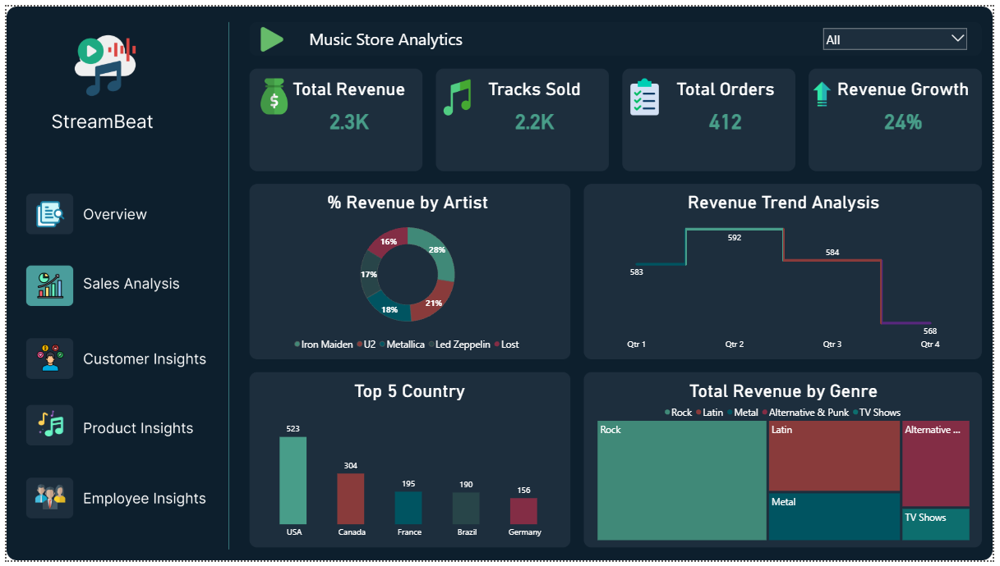

# 🎵 StreamBeat — Music Store Analytics Dashboard

An interactive 5-page business intelligence dashboard analyzing digital music store performance, revenue trends, customer behavior, product catalog sales, and employee productivity across **$2.3K in total revenue**, **2.2K tracks sold**, **412 orders**, and **59 customers**. Designed with a unified dark-mode sidebar navigation and top-level dynamic filtering.

---

## 📊 Dashboard Pages & Screenshots

### 1. Overview
Provides an executive summary of store revenue, order volume, top-performing artists, monthly revenue trajectory, and leading country markets.

* **KPIs:** Total Revenue (`2.3K`), Tracks Sold (`2.2K`), Total Orders (`412`), Total Customers (`59`)
* **Visuals:**
  * **Top 5 Artist by Tracks Sold:** Horizontal bar chart led by `Iron Maiden` (`140`), `U2` (`107`), `Metallica` (`91`), `Led Zeppelin` (`87`), and `Os Paralamas do Sucesso` (`45`).
  * **Total Revenue by Month:** Line chart tracking monthly revenue from `Jan` (`201`) to `Nov` (`186`).
  * **Top 5 Country Sales Ranking:** Summary table ranking `USA` (`91` orders, `494` tracks, `523.06` revenue), `Canada` (`56` orders, `304` tracks, `303.96` revenue), `France` (`35` orders, `190` tracks, `195.10` revenue), `Brazil` (`35` orders, `190` tracks, `190.10` revenue), and `Germany` (`28` orders, `152` tracks, `156.48` revenue).

---

### 2. Sales Analysis
Breaks down revenue contribution by top artists, quarterly revenue trends, top countries, and genre performance.

* **KPIs:** Total Revenue (`2.3K`), Tracks Sold (`2.2K`), Total Orders (`412`), Revenue Growth (`24%`)
* **Visuals:**
  * **% Revenue by Artist:** Donut chart comparing top 5 revenue shares: `Iron Maiden` (`28%`), `U2` (`21%`), `Metallica` (`18%`), `Led Zeppelin` (`17%`), and `Lost` (`16%`).
  * **Revenue Trend Analysis:** Stepped/waterfall trend across quarters (`Qtr 1`: `583`, `Qtr 2`: `592`, `Qtr 3`: `584`, `Qtr 4`: `568`).
  * **Top 5 Country:** Column chart led by `USA` (`523`), `Canada` (`304`), `France` (`195`), `Brazil` (`190`), and `Germany` (`156`).
  * **Total Revenue by Genre:** Treemap highlighting top genres led by `Rock`, `Latin`, `Metal`, `Alternative & Punk`, and `TV Shows`.

---

### 3. Customer Insights
Analyzes geographic customer concentration, highest-spending individuals, order patterns, and average customer spend over time.

* **KPIs:** Total Revenue (`2.3K`), Total Customers (`59`), Avg Customer (`39`), Avg Order (`39`)
* **Visuals:**
  * **Top 10 Customers by Country:** Pie chart showing customer share led by `USA` (`37%`), `Canada` (`23%`), `France` (`14%`), `Brazil` (`14%`), and `Germany` (`11%`).
  * **Top 10 Customers by Revenue:** Column chart led by `Frank` (`81`), `Mark` (`75`), `Helena` (`50`), `Richard` (`48`), and `Luis` (`47`).
  * **Orders Trend Analysis:** Area chart tracking monthly order volume (`33` to `35` orders/month).
  * **Customer Spend Trend:** Line chart tracking average customer spend across months (`3.2` to `3.4`).

---

### 4. Product Insights
Evaluates catalog size, pricing, media format preferences, and revenue generation across artists and music genres.

* **KPIs:** Total Tracks (`3.5K`), Total Revenue (`2.3K`), Tracks Sold (`2.2K`), Avg Price (`1.04`)
* **Visuals:**
  * **Top 5 Country by Tracks Sold:** Funnel chart led by `USA` (`523`), `Canada` (`304`), `France` (`195`), `Brazil` (`190`), and `Germany` (`156`).
  * **Top 5 Artists by Revenue:** Horizontal bar chart led by `Iron Maiden` (`139`), `U2` (`106`), `Metallica` (`90`), `Led Zeppelin` (`86`), and `Lost` (`82`).
  * **Tracks Sold by Media Type:** Column chart dominated by `MPEG audio file` (`1,976`), followed by `Protected AAC audio file` (`146`) and `Protected MPEG-4 video file` (`111`).
  * **Top 10 Revenue by Genre:** Column chart led by `Rock` (`827`), `Latin` (`382`), `Metal` (`261`), and `Alternative & Punk` (`242`).

---

### 5. Employee Insights
Tracks sales support representative performance, customer portfolio distribution, annual revenue trends, and genre sales shares by employee.

* **KPIs:** Total Employee (`8`), Total Customers (`59`), Avg Revenue (`291`), Avg Order (`52`)
* **Visuals:**
  * **Total Customers by Employee:** Column chart showing customer assignments across `Jane` (`21`), `Margaret` (`20`), and `Steve` (`18`).
  * **Total Revenue by Date and Employee:** Stacked area chart comparing annual revenue from `2021` to `2025` across `Jane`, `Margaret`, and `Steve`.
  * **% Revenue by Employee:** Donut chart splitting total sales revenue among `Jane` (`36%`), `Margaret` (`33%`), and `Steve` (`31%`).
  * **Top 5 Orders by Genre and Employee:** 100% stacked column chart showing consistent genre distribution (`Jane`: `35%`, `Margaret`: `34%`, `Steve`: `31%`) across `Sci Fi & Fantasy`, `Science Fiction`, `Soundtrack`, `TV Shows`, and `World`.

---

## 💡 Key Insights
* **Rock & MPEG Dominance:** `Rock` is the #1 revenue-generating genre (`827`), and `MPEG audio file` accounts for nearly `90%` (`1,976` of `2.2K`) of all tracks sold.
* **North American Market Leadership:** `USA` and `Canada` together generate over `35%` of total store revenue (`523.06` and `303.96`) and `60%` of the top-country customer base.
* **Balanced Sales Team Performance:** Revenue is evenly distributed across the three sales support agents, with `Jane` leading slightly at `36%` (`21` customers), followed by `Margaret` at `33%` (`20` customers) and `Steve` at `31%` (`18` customers).
* **Top Artist Driver:** `Iron Maiden` leads both track volume (`140` tracks) and revenue (`139`, or `28%` of top-5 artist revenue).

---

## 🛠️ Tools & Technologies
* **Visualization:** Power BI / Excel *(update based on your source file format)*
* **Data Modeling & Measures:** DAX / Power Query (Chinook Music Store Dataset)

