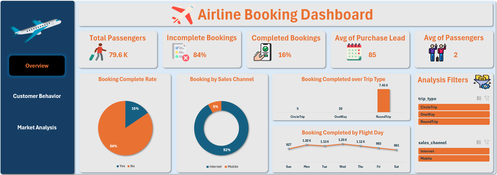

# 🛒 Retail Sales, Product, Store & Customer Analytics Dashboard

An interactive 4-page business intelligence dashboard built in **Microsoft Power BI** analyzing retail sales revenue, product performance, store types, geographic expansion, and customer purchasing behavior across **10K customers**, **2K products**, **24 cities**, and **$1.65M in total revenue** ($1.93M gross sales).

---

## 📊 Dashboard Pages & Screenshots

### 1. Sales Overview (`Sales Overview Performance`)
Provides an executive overview of total sales, year-to-date revenue, costs, top-performing cities, state rankings, brand shares, and revenue vs. cost trends.

* **KPIs:** Total Sales (`1.93M`), Revenue YTD (`967.23K`), Avg Revenue Per Store/City (`68.82K`), Total Cost (`1.65M`)
* **Visuals:**
  * **Cities Sales:** Horizontal bar chart with Store Type filter buttons (`Deluxe Supermarket`, `Gourmet Supermarket`, `Mid-Size Grocery`, `Small Grocery`, `Supermarket`), led by `Salem` (`203K`), `Tacoma` (`184K`), `Portland` (`135K`), `Seattle` (`135K`), and `Los Angeles` (`131K`).
  * **Sales by Product Brand:** Pie chart breaking down brand revenue shares: `Hermanos` (`55.14K` / `22.79%`), `Tell Tale` (`50.47K` / `20.86%`), `Tri-State` (`46.91K` / `19.39%`), `Ebony` (`46.26K` / `19.12%`), and `High Top` (`43.12K` / `17.83%`).
  * **State Sales:** Column chart led by `WA` (`655K`), `CA` (`386K`), `OR` (`338K`), and `Zacatecas` (`158K`).
  * **Sales Trend:** Dual-line chart comparing `Sum of total_revenue` vs. `Sum of total_cost` over time.

---

### 2. Product Analysis (`Product Analysis Performance`)
Explores product catalog volume, unit sales, return rates, top-selling brands, individual products, and interactive root-cause revenue drill-downs.

* **KPIs:** Total Products (`2K`), Total Quantity Sold (`2M`), Total Transactions (`441`), Return Rate % (`16.07%`)
* **Visuals:**
  * **Revenue Decomposition Tree:** Interactive AI drill-down breaking `Total Revenue` (`1,651,567.97`) down by `country` (`USA`: `1,178,444.61`, `Mexico`: `386,456.68`, `Canada`: `86,666.68`), `city` (`Salem`: `172,560.81`, `Tacoma`: `157,417.43`), and `product_brand` (`Hermanos`: `6,228.30`, `Tell Tale`: `5,789.29`).
  * **Top Branding Sales:** Horizontal bar chart led by `Hermanos` (`55K`), `Tell Tale` (`50K`), `Tri-State` (`47K`), and `Ebony` (`46K`).
  * **Top 10 Product Sales:** Column chart led by `Carlson Head Cheese` (`2.7K`), `Moms Foot-Long Hot Dogs` (`2.7K`), and `Tell Tale Cantaloupe` (`2.5K`).

---

### 3. Store Analysis (`Store Analysis Performance`)
Evaluates store format performance, geographic presence across North America, and year-over-year YTD revenue growth.

* **KPIs:** Total Revenue (`1.65M`), Total Products (`2K`), Top Store Sales (`203K`), # Cities (`24`)
* **Visuals:**
  * **Store Type Sales:** Horizontal bar chart led by `Supermarket` (`766K`) and `Deluxe Supermarket` (`606K`), followed by `Gourmet Supermarket` (`142K`), `Mid-Size Grocery` (`105K`), and `Small Grocery` (`33K`).
  * **Country Sales:** Geographic map displaying revenue distribution across `United States`, `Mexico`, and `Canada`.
  * **Revenue YTD by Year:** Ribbon/area comparison showing growth from `1997` (`684K`) to `1998` (`967K`) — a **+41.4%** increase.

---

### 4. Customer Analysis (`Customer Analysis Performance`)
Analyzes customer base size, average revenue per customer, gender distribution, top spenders, and a searchable transaction ledger.

* **KPIs:** Total Customers (`10K`), Total Revenue (`1.65M`), Top Customer (`Ida Rodriguez`), Revenue Per Customer (`161`)
* **Visuals:**
  * **Top 5 Customers:** Horizontal bar chart led by `Ida Rodriguez` (`2.2K`), `James Horvat` (`2.1K`), `Mary Francis Benigar` (`2.0K`), `Wildon Cameron` (`2.0K`), and `Dawn Laner` (`1.9K`).
  * **Total Revenue by Gender:** Donut chart showing revenue split between `Male` (`6.17K` / `60.92%`) and `Female` (`3.96K` / `39.08%`).
  * **Customers Transaction Table:** Searchable detailed table (`Enter Full_name` filter) listing `Full_name`, `country`, `Total Quantity Sold` (`1,933,751`), `Revenue YTD` (`967,230.02`), and `Total Revenue` (`1,651,567.97`).

---

## 💡 Key Insights
* **Strong YoY Growth:** YTD revenue surged by **41.4%** from `684K` in `1997` to `967K` in `1998`.
* **Dominant Store Formats:** `Supermarket` (`766K`) and `Deluxe Supermarket` (`606K`) generate **83.1%** of total store revenue.
* **Geographic Concentration:** The `USA` accounts for over **71%** of total revenue (`1.18M`), led by Washington (`WA` at `655K`) and top city `Salem` (`203K` gross / `172.56K` net revenue).
* **Brand Leadership:** `Hermanos` is the top revenue-generating brand (`55.14K` / `22.79%`), followed closely by `Tell Tale` (`50.47K` / `20.86%`).

---

## 🛠️ Tools & Technologies
* **Microsoft Power BI Desktop** (`.pbix`)
* **DAX (Data Analysis Expressions):** Time-intelligence measures (`Revenue YTD`), return rate calculations, and customer averages
* **Power Query:** Data cleaning, transformation, and star-schema modeling
* **Interactive Visuals:** Decomposition Tree, Map, Ribbon Chart, Donut/Pie Charts, Custom Page Navigation Buttons, and Search Slicers

